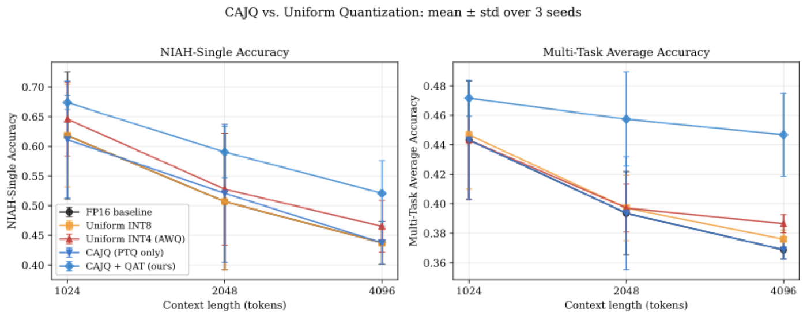

# SynapNet-Edge

[](https://opensource.org/licenses/MIT)
[](https://www.python.org/downloads/)
[](https://huggingface.co/Vineetha00/synapnet-edge)
[](CITATION.cff)

**Efficient long-context AI inference on consumer hardware — quantised hybrid SSM + sparse attention + episodic-memory architecture, reproducible end-to-end in ~25 minutes on a MacBook.**



📄 **Paper:** arXiv preprint — link coming soon
🤗 **Checkpoints:** https://huggingface.co/Vineetha00/synapnet-edge
🧪 **Companion repo (base architecture):** [SynapNet_Exp](https://github.com/vineetha00/SynapNet_Exp)

SynapNet-Edge is an original research framework. The base SynapNet architecture is developed in the companion repository [SynapNet_Exp](https://github.com/vineetha00/SynapNet_Exp).

---

## Three Core Contributions

### 1. Component-Aware Joint Quantization (CAJQ)

Different quantization strategies per architectural component:

| Component | Method | Bits | Rationale |
|-----------|--------|------|-----------|
| SSM layers | ParetoQ-style QAT | **2-bit** | Near-zero-mean depthwise weights; learned per-channel step size preserves accuracy |
| Sparse attention | SmoothQuant + AWQ | **INT4** | Per-channel smoothing migrates activation outliers to weights; group-wise INT4 |
| Episodic memory | Per-entry symmetric | **INT8** | Per-slot scale absorbs entry diversity |
| Interface layer | FP16 ScaleBridge | **FP16** | Absorbs scale mismatches between mixed-precision pathways |

**Compression** (8.7M-param reference model, trained checkpoint, measured on a Raspberry Pi 4): the original CAJQ configuration gives **4.4× compression on the targeted SSM + attention parameters** (0.60 MB vs 2.66 MB FP16-equivalent) but only **1.13× whole-model**, because the FF, embedding, memory-projection and ScaleBridge layers stay FP16. **CAJQ-Full** (`scripts/cajq_full.py`) keeps the component-aware core and quantizes those remaining Linear layers too:

| Variant | Whole-model on-disk | vs FP16 |
|---|---|---|
| FP16 | 16.60 MB | 1.00× |
| CAJQ (original) | 15.06 MB | 1.10× |
| **CAJQ-Full INT8** | **10.18 MB** | **1.63×** |
| **CAJQ-Full INT4** | **8.35 MB** | **1.99×** |
| CAJQ-Full INT8, ScaleBridge kept FP16 | 12.08 MB | 1.37× |
| Uniform INT8 | 10.55 MB | 1.57× |
| Uniform INT4 | 8.29 MB | 2.00× |

At INT8, CAJQ-Full is smaller than uniform INT8 because attention stays at INT4; at INT4 it is a tie with uniform INT4, because the salience MLP stays FP16 and the 2-bit SSM's per-channel scales use up most of its saving. Sizes include the 3 MB FP16 learned positional embedding, which no variant quantizes and which the estimator in `exp_deployment_metrics.py` does not count. Raw data: `results/scaled/pi_cajq_full_trained.json`.

**Accuracy** (`scripts/exp_cajq_full_accuracy.py`: 11 variants on the trained checkpoint, 3 seeds, NIAH-single and multi-task at 1024 / 2048 / 4096 tokens, 128 questions per task, identical questions for every variant, paired bootstrap 95% CIs):

- **Post-training quantization costs no measurable accuracy.** Uniform INT8/INT4, CAJQ and CAJQ-Full INT8/INT4 are all within ±2 points of FP16 at every context length.
- **The QAT gain is a fine-tuning effect.** The 200-step QAT recipe lifts FP16 itself by +4 to +9 points. Against an FP16 model fine-tuned with the same recipe, CAJQ-QAT matches rather than exceeds it (NIAH-single −0.023 [−0.044, −0.003] at 4K). An earlier version of this README reported CAJQ-QAT as "matching or exceeding FP16" against an FP16 baseline that had not been fine-tuned; that comparison mixed fine-tuning into the quantization result.
- **Fully quantized models recover less from fine-tuning.** At 2–4K tokens, uniform INT4 and CAJQ-Full INT8/INT4 end 3.6–6.5 NIAH points below fine-tuned FP16, because their low-bit weights are frozen during the fine-tune. CAJQ-Full INT4 recovers slightly more than uniform INT4 (+1 to +2 points), but the CI only reaches zero at 2K.

Raw data: `results/scaled/exp_cajq_full_accuracy.json`. The figure above is from the original 48-question run.

### 2. Budget-Aware Episodic Eviction (BAEE)

A lightweight retention-score classifier (**~3.3K parameters**) that progressively compresses memory entries under RAM constraints:

```
FP16 (hot) → INT8 (warm) → summary token (cold) → eviction
```

- **RetentionClassifier**: 3-layer MLP; validation ROC-AUC = **0.907 ± 0.005** (3 seeds), robust across a 10× learning-rate range and graceful under label noise.
- **Budget enforcement**: triggers compression stages when total memory exceeds a configurable threshold (default: 256 MB).
- **vs FIFO / LRU**: BAEE retains semantically important entries regardless of recency. Under 90% forced eviction with the target needle in the *early* portion of an 8K-token stream, BAEE retains the target **71% ± 8%** of the time vs **0%** for FIFO/LRU.
- **vs learned KV-cache eviction**: head-to-head 432-cell grid against H2O, Scissorhands, SnapKV, PyramidKV, and a Locret-style proxy positions BAEE competitively across budget × position regimes (see `paper/figures/v3_fig_kv_policy_grid.pdf`).

### 3. Consumer Hardware Benchmarking Suite

Three hardware tiers profiled:
- **Apple Silicon (MPS)** — measured directly
- **Multi-thread CPU** — measured directly
- **Single-thread CPU (Raspberry Pi proxy)** — measured directly on an Apple M3 (real Pi throughput is lower per core)
- **Raspberry Pi 4 (4× Cortex-A72, Raspberry Pi OS Lite 64-bit)** — measured directly on the trained checkpoint (`results/scaled/pi_cajq_full_trained.json`). The FP16 forward pass at 1024 tokens takes 2.04 s on 1 core and 1.30 s on 4 cores (1.56×). The PyTorch fake-quantized variants are *slower* than FP16 in every configuration (CAJQ-Full INT8 2–15%, CAJQ-Full INT4 5–18%, uniform INT4 up to 29%), and peak RSS stays ~320–385 MB for every variant: weights are dequantized to float on each pass and the PyTorch runtime, not the 8–17 MB of weights, dominates memory. See *Real INT8 kernels* below for the path to an actual speedup.

Metrics reported: parameter memory, on-disk storage, activation memory, episodic-store growth, runtime RSS, sustained throughput under 45-second thermal stress, and an energy/token estimate from `powermetrics` (with rated-TDP fallback).

Benchmarks: RULER-style (NIAH, variable tracking, frequency aggregation) + LongBench-style (6 task categories) + NeedleBench-style (SNIA / MKN / RoN / CN / ADN), all with self-contained synthetic data — no external downloads required.

### Real INT8 kernels (ONNX Runtime)

The CAJQ pipeline above uses *fake quantization* (quantize→dequantize in PyTorch), which measures accuracy effects faithfully but executes every matmul in floating point — so the quantized variants show no latency win. To demonstrate that the architecture actually gets faster on real integer kernels, `scripts/exp_real_int8_onnxruntime.py` exports the **full SynapNetEdge forward pass** (embedding → 6 × [SSM + sparse-attn + episodic memory + ScaleBridge + FF] → head) at the 8.7M-param reference dimensions (random-init weights — latency is independent of weight values) to ONNX and applies ONNX Runtime **dynamic INT8 quantization in QOperator format** (`DynamicQuantizeLinear` + `MatMulInteger`, weights QInt8) to all weight-bearing MatMul/Gemm ops; attention-score matmuls, softmax, LayerNorm and the depthwise SSM conv stay FP32 in both variants, so the speedup below is honest end-to-end, not a matmul microbench. Measured on Apple M3 (arm64 macOS), CPUExecutionProvider, batch 1, seq_len 1024, 10 warmup + 50 timed runs; the single-thread row (`intra_op_num_threads=1`) matches the repo's "Raspberry Pi proxy, single-thread CPU" methodology. FP32→INT8 logits Pearson r = 0.985.

| Threads | FP32 mean (ms) | INT8 mean (ms) | FP32 p50 | INT8 p50 | FP32 p90 | INT8 p90 | Speedup (mean) |
|---|---|---|---|---|---|---|---|
| 1 (M3, single thread) | 277.82 | 180.19 | 273.02 | 176.54 | 322.04 | 201.65 | **1.54×** |
| default | 155.56 | 109.70 | 155.30 | 107.98 | 164.54 | 116.00 | **1.42×** |

Model file: **29.40 MB (FP32) → 10.61 MB (INT8)**, 2.77× smaller. Full details in `results/real_int8_onnxruntime.json` (includes the exact exported target, quantized op types, and platform).

**Caveats.** (1) The Apple M3 has INT8 dot-product instructions (SDOT / I8MM) that the Raspberry Pi 4's Cortex-A72 (ARMv8.0) lacks, so the single-thread M3 row is an optimistic stand-in for a Pi; the speedup on a real Pi 4 has not been measured yet and is likely smaller. (2) The 2.77× file ratio is against FP32; against the FP16 baseline used elsewhere in this README it is about 1.4×. (3) The export uses a static `seq_len` of 1024, and the FP32 file is ~5.5 MB smaller than the model's full FP32 weights, consistent with the positional table being trimmed to 1024 positions — these files serve 1024-token inputs only. (4) The logit correlation was measured on random-init weights; INT8 task accuracy on the trained checkpoint has not been measured.

```bash
# Reproduce (any machine):
pip install torch onnx onnxruntime numpy
python scripts/exp_real_int8_onnxruntime.py --runs 50 --seq-len 1024

# On a Raspberry Pi (aarch64 Linux) — same script, no changes:
python3 -m venv .venv && . .venv/bin/activate
pip install torch onnx onnxruntime numpy
python scripts/exp_real_int8_onnxruntime.py --runs 50 --seq-len 1024
```

---

## Architecture

```
Input tokens
    │
    ▼
Token + Position Embedding
    │
    ├─ [× depth] SynapBlockWithEpisodic
    │       │
    │       ├─ SimpleSSM (depthwise conv, 2-bit QAT)
    │       │
    │       ├─ SparseEventAttention (INT4 AWQ + SmoothQuant)
    │       │       └─ salience mask → BAEE scoring
    │       │
    │       ├─ WriteableMemory (INT8 per-entry)
    │       │       ├─ write: top-K salient tokens → slots
    │       │       └─ read: cross-attention to slots
    │       │
    │       └─ ScaleBridge (FP16 — normalises 3 pathway outputs)
    │
    ▼
LayerNorm → Head (classification or LM)
```

---

## Installation

```bash
git clone https://github.com/vineetha00/SynapNet-Edge
cd SynapNet-Edge
pip install -e .
# Optional extras:
pip install -e ".[dev]"      # + psutil, pyyaml, scipy, tqdm
pip install -e ".[mlx]"      # + Apple MLX for iPhone/Mac deployment
pip install -e ".[full]"     # + HuggingFace datasets for real LongBench
```

---

## Quickstart

### Pretrain the reference 8.7M model (~10 min on M-series MPS)

```bash
python scripts/pretrain_scaled.py \
  --dim 192 --depth 6 --heads 6 \
  --curriculum 512 1024 \
  --device mps
```

### Train with CAJQ (3-phase QAT, ~15 min for 3 seeds)

```bash
python scripts/exp_cajq_qat_multiseed.py \
  --context-lengths 1024 2048 4096 \
  --seeds 42 43 44 \
  --device mps
```

### Run BAEE grid vs all baselines (432 cells, ~35 min)

```bash
python scripts/exp_baee_grid_multiseed.py \
  --policies baee_salience fifo lru random h2o scissorhands snapkv pyramidkv locret_proxy \
  --budgets 0.10 0.20 0.30 0.50 \
  --positions early late \
  --seeds 42 43 44 \
  --device mps
```

### Hardware deployment profile (3 tiers, ~6 min)

```bash
python scripts/exp_deployment_metrics.py \
  --tiers apple_silicon_mps cpu_multi cpu_single \
  --variants fp16 int8_uniform int4_uniform cajq cajq_full_int8 cajq_full_int4
```

### CAJQ-Full accuracy re-check (11 variants incl. fine-tune-matched FP16 control, ~2 h on M-series MPS)

```bash
bash scripts/run_cajq_full_accuracy.sh smoke   # ~3 min sanity check
bash scripts/run_cajq_full_accuracy.sh full    # 3 seeds x ctx 1024/2048/4096, runs in background
```

### Generate all paper figures

```bash
python scripts/generate_paper_figures_v3.py
```

---

## Usage in Code

```python
from synapnet_edge import SynapNetEdge, SynapNetEdgeConfig, apply_cajq, BAEEMemoryManager
from synapnet_edge.quantization.cajq import CAJQConfig
from synapnet_edge.training.calibration import build_calib_loader

# Build the reference 8.7M model
cfg = SynapNetEdgeConfig(
    dim=192, depth=6, vocab_size=4096, max_len=8192,
    num_classes=64, heads=6, episodic_slots=32,
)
model = SynapNetEdge(cfg)

# Apply CAJQ quantization (PTQ; QAT entry point in scripts/exp_cajq_qat_multiseed.py)
calib_loader = build_calib_loader(n_samples=128, seq_len=1024)
model = apply_cajq(model, CAJQConfig(device="mps"),
                    calib_loader=calib_loader, mode="ptq")

# Streaming inference with BAEE
manager = BAEEMemoryManager(dim=192, n_layers=6, budget_mb=256.0)
logits, debug = model.forward_streaming(
    input_ids, chunk_size=512, baee_manager=manager
)
```

---

## Repository Structure

```
SynapNet-Edge/
├── synapnet_edge/
│   ├── models/                          # SSM / SparseAttn / Episodic / SynapBlock / full model
│   ├── quantization/                    # CAJQ + 2-bit / INT4 / INT8 / ScaleBridge
│   ├── memory/
│   │   ├── baee.py                      # BAEEMemoryManager + RetentionClassifier (~3.3K params)
│   │   └── kv_cache_policies.py         # H2O / Scissorhands / SnapKV / PyramidKV / Locret
│   ├── benchmarks/                      # RULER / LongBench / hardware / Pareto
│   ├── baselines/                       # Mamba-2 / Llama-AWQ / Falcon-H1 / EM-LLM proxies
│   ├── training/                        # QAT trainer + calibration
│   ├── data/long_context_tasks.py       # NIAH / MultiKey / VarTrack / FA / NeedleBench / MemPressure
│   └── utils/                           # profiling + visualisation
├── scripts/                             # 18 reproducible experiment scripts
├── configs/                             # YAML configs for CAJQ / BAEE / benchmarks
├── results/                             # JSON outputs for every experiment
├── paper/figures/                       # 20+ publication-quality PDFs + v3 paper summary
├── CITATION.cff                         # citation metadata
├── LICENSE                              # MIT
└── README.md
```

---

## Baselines

| Model | Architecture | Bits | Role |
|-------|-------------|------|------|
| Mamba-2 (proxy) | GRU-SSM | INT4 uniform | Approximates Mamba-2 selective scan |
| Llama-3.2 (proxy) | Full dense attention | INT4 AWQ | O(T²) cost reference |
| Falcon-H1 / Hymba (proxy) | Hybrid SSM + attention | FP16 | Upper-bound hybrid reference |
| EM-LLM | Transformer + external memory | FP16 | Memory-mechanism ablation |
| H2O / Scissorhands / SnapKV / PyramidKV / Locret-proxy | KV-cache eviction policies | — | Eviction-policy baselines (BAEE comparison) |

---

## Ablations

- **Quantization strategy**: FP16 / Uniform INT8 / Uniform INT4 / CAJQ-PTQ / **CAJQ-QAT (ours)** / **CAJQ-Full INT8 / INT4 (ours)**, each with and without the same 200-step fine-tune, against a fine-tune-matched FP16 control — see `scripts/exp_cajq_full_accuracy.py` (original run: `scripts/exp_cajq_qat_multiseed.py`)
- **Eviction policy**: **BAEE (ours)** / FIFO / LRU / Random / H2O / Scissorhands / SnapKV / PyramidKV / Locret — see `scripts/exp_baee_grid_multiseed.py`
- **ScaleBridge**: post-hoc removal collapses accuracy (load-bearing in trained model); from-scratch comparison is inconclusive at our compute budget — see `scripts/exp_scale_bridge_ablation.py`
- **Classifier stability**: seed × LR × label-noise grid — see `scripts/exp_classifier_stability.py`

---

## Limitations

- **No speed or RAM win on the Raspberry Pi 4 from PyTorch fake-quant.** Real INT8 kernels (ONNX Runtime) give a speedup on Apple M3 but have not been measured on the Pi yet.
- **Fine-tuning freezes the quantized weights**, which is why fully quantized models recover less from QAT. Straight-through fake-quant for the FF layers is future work.
- **The size estimator skips the positional embedding.** The numbers above add it back; the script itself is not fixed yet.
- **The `ScaleBridge kept FP16` variants' accuracy is unmeasured**, so that compromise is priced in MB but not yet in accuracy.
- **Synthetic benchmarks only.** NIAH multi-key sits near 0.1 for every variant, so it cannot separate them; standard long-context suites (RULER, LongBench) are future work.

---

## Citation

```bibtex
@article{synapnet_edge_2026,
  title={SynapNet-Edge: Component-Aware Quantization and Budget-Aware Eviction for Hybrid Long-Context Models on Consumer Hardware},
  author={Vallish Kumar, Vineetha},
  year={2026},
}
```

---

## License

Released under the [MIT License](LICENSE).

---

## Acknowledgements

Quantization methods inspired by [ParetoQ](https://arxiv.org/abs/2408.08296),
[SmoothQuant](https://arxiv.org/abs/2211.10438), and [AWQ](https://arxiv.org/abs/2306.00978).
Memory eviction inspired by [EM-LLM](https://arxiv.org/abs/2407.09450),
[MemGPT](https://arxiv.org/abs/2310.08560), and the KV-cache compression line of work
([H2O](https://arxiv.org/abs/2306.14048), [Scissorhands](https://arxiv.org/abs/2305.17118),
[SnapKV](https://arxiv.org/abs/2404.14469), [PyramidKV](https://arxiv.org/abs/2406.02069)).
